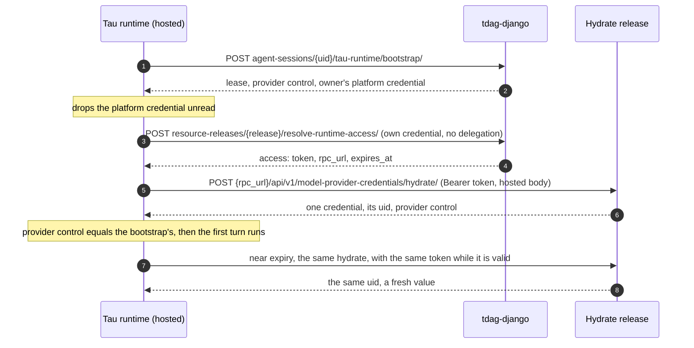
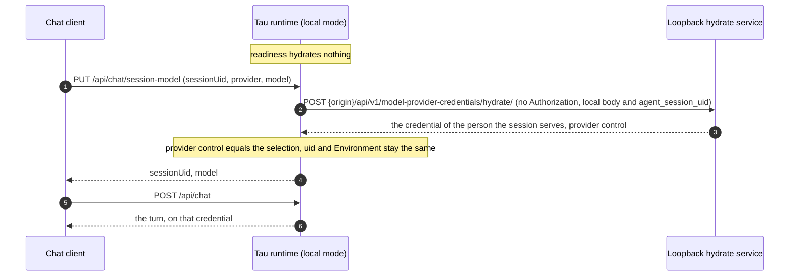

# ADR 0027: Custom Provider Credential Hydrate Endpoints

Status: Accepted — implemented 2026-11-10

Date: 2026-11-08

Amended: 2026-11-10 — two decisions of the owner, built with the ADR:

- **A local hydrate address.** In local mode only, `TAU_LOCAL_PROVIDER_CREDENTIAL_HYDRATE_URL` may
  name the developer's own hydrate service on a loopback address. The runtime sends it no
  credential of any kind. Sections 1, 5 and 8 and Rejected are edited.
- **Local hydration names the session.** In local mode with a custom endpoint, every hydration
  names the local session it is for in `agent_session_uid`, and local readiness hydrates nothing.
  Sections 2, 3 and 7 and the acceptance criteria are edited.

Amended: 2026-11-13 by
[ADR 0030: Hosted model calls go through a relay](./0030-hosted-model-calls-go-through-a-relay.md),
for 3.0.0. In a hosted session a custom endpoint answers a session pass and its own relay address,
never a secret, and the application runs the relay. Sections 2 and 3 and Requirements of the
platform are edited.

Amends:

- [ADR 0005: Authenticated local development mode](./0005-authenticated-local-development-mode.md).
  Provider credential hydration stays remote in local mode, but it is owned by Main Sequence only
  while no custom hydrate endpoint is configured. With a custom endpoint, local readiness no
  longer proves provider control, and a local address keeps hydration on the developer's machine.

## Context

A session's model credential comes from tdag-django, the platform backend. The runtime bootstrap
answers the first credential together with the lease, and the runtime hydrates again near expiry
by posting `/api/v1/model-provider-credentials/hydrate/` with its Main Sequence credential.
tdag-django picks the credential of the session's owner, refreshes an expiring OAuth token before
it answers, and returns a `ProviderControl` projection of what the selected model may do.
`ProviderFactory` builds the provider from that answer and keeps the value in memory only.

An application may serve people the platform does not know. It authenticates them itself, and each
person may connect their own model credential to it, such as a ChatGPT subscription or an
OpenRouter key. The application's rule is that the person's conversations run on that credential,
not on the Organization's. The platform must not grow an owner kind or a credential store for one
application's people. The application keeps the credentials, so the runtime must be able to
hydrate from it.

The answer to a hydrate request is a person's live model credential, while nothing in the request
is secret: a session uid appears in URLs, logs and the caller's own records. The endpoint must
therefore know that the runtime is calling. The runtime cannot prove it with what it holds. Its
Main Sequence credential could be replayed against the platform with the runtime's full scope, and
its lease token would let the receiver renew or release the session and write its entries. Main
Sequence issues no static secrets, so a shared bearer token is not an option either. The platform
already mints short-lived tokens for one FastAPI release, which is how the runtime calls declared
applications (ADR 0021).

## Decisions

### 1. tdag-django is canonical; a custom endpoint implements its contract

tdag-django's hydrate endpoint defines the hydrate contract, and tdag-django is its canonical
implementation. This ADR changes nothing in tdag-django.

A custom hydrate endpoint implements the same contract and does, for its own people, the
credential management tdag-django does for platform Users (section 6). It is one of two:

- **A release.** `MAINSEQUENCE_TAU_PROVIDER_CREDENTIAL_HYDRATE_RELEASE_UID` names a FastAPI release
  that serves hydrate, in hosted and in local mode.
- **A local address** (amended 2026-11-10). In local mode only,
  `TAU_LOCAL_PROVIDER_CREDENTIAL_HYDRATE_URL` names the developer's own service on a loopback
  address. Local mode has no release of its own, and the platform cannot mint a token for a
  developer's local process.

Which one applies:

- **Neither set, or empty:** the runtime hydrates from tdag-django, exactly as today. Nothing else
  in this ADR applies.
- **One set:** every hydration the process makes goes to that endpoint, and none goes to
  tdag-django. The setting is process-wide, so it applies to every Agent and session the process
  serves.
- **Both set:** a configuration error at startup that names both settings.

For a release the runtime never configures an address. The platform answers the release's RPC URL
with each token (section 5), and the runtime posts to
`{rpc_url}/api/v1/model-provider-credentials/hydrate/`, the path tdag-django serves. A value that is
not a UID is a configuration error at startup that names the setting.

A local address is an `http` or `https` origin whose host is `127.0.0.1`, `::1` or `localhost`,
with an optional port and no path other than `/`, no query, fragment or user information. The
runtime posts to `{origin}/api/v1/model-provider-credentials/hydrate/`. Any other value, or the
setting without `TAU_LOCAL_MODE=true`, is a configuration error at startup that names the setting
and never repeats its value.

The runtime calls only hydrate. It never calls `status`, `flush` or `revoke`, so a custom endpoint
implements hydrate alone.

### 2. The request

`POST {rpc_url}/api/v1/model-provider-credentials/hydrate/`, or
`POST {origin}/api/v1/model-provider-credentials/hydrate/` for a local address, with
`Content-Type: application/json` and the body the runtime sends tdag-django in the same mode. In
local mode the body also names the local session (amended 2026-11-10). In hosted mode:

```json
{
  "agent_session_uid": "7d1c2f4e-0b6a-4f0e-9a51-3c2d8e9b1a77",
  "providers": ["openai-codex"],
  "holder_id": "tau-runtime-5f9c",
  "supported_provider_control_schema_versions": [1],
  "execution_selection": {"provider": "openai-codex", "model": "gpt-5.5"}
}
```

| Field | Rule |
| --- | --- |
| `agent_session_uid` | The session the hydration is for. In hosted mode, the platform session. In local mode, the local session's canonical uid, the `sessionUid` that `GET /api/chat/session-model` reports (amended 2026-11-10); tdag-django's local body has none. |
| `providers` | Exactly one provider, equal to `execution_selection.provider`. |
| `holder_id` | The runtime's lease holder, for the endpoint's audit. |
| `supported_provider_control_schema_versions` | Always contains `1`. |
| `execution_selection` | `provider` and `model`; in local mode also `thinking_level` when one is selected. |
| `custom_id` | Optional. A configured credential the person chose by name. |
| `organization_environment_uid` | Local mode only, optional. The Environment the developer selected. |

In local mode with a custom endpoint the body is:

```json
{
  "agent_session_uid": "local-3f2a9c1d7b4e-default",
  "providers": ["openai-codex"],
  "holder_id": "devbox:5f9c",
  "supported_provider_control_schema_versions": [1],
  "execution_selection": {"provider": "openai-codex", "model": "gpt-5.5", "thinking_level": "high"}
}
```

The rest of the local body is unchanged: `organization_environment_uid` and `custom_id` when they
are set. Without a custom endpoint, the local body is byte for byte what it was.

From 3.0.0 the hosted body also carries `"supported_model_relay_versions": [1]`, as tdag-django's
does (ADR 0030, amended 2026-11-13). The local body never carries it.

The body never names a person. The endpoint decides whose credential answers from the session, as
tdag-django derives it from the session's owner. In local mode it decides from the local session
the body names: the developer's process that opened that session knows the person it serves. It
refuses a body that tries to choose the owner, as tdag-django refuses `created_by_user_uid` and
`agent_uid`.

### 3. The answer

`200` with the shape of tdag-django's `ModelProviderCredentialHydrateResponseSerializer`:

```json
{
  "credentials": {
    "openai-codex": {
      "uid": "<the endpoint's stable credential id>",
      "status": "active",
      "credential_kind": "oauth",
      "version": 7,
      "credential_hash": "sha256:...",
      "credential": {
        "type": "oauth",
        "access": "<access token>",
        "expires": 1770000000000
      }
    }
  },
  "missing": [],
  "revoked": [],
  "provider_control": {
    "schema_version": 1,
    "catalog_digest": "sha256:<64 hex digits>",
    "provider": "openai-codex",
    "model": {
      "model": "gpt-5.5",
      "api": "openai-codex-responses",
      "input": ["text", "image"],
      "reasoning": true,
      "thinking_levels": ["low", "medium", "high"]
    }
  }
}
```

- **One entry.** `credentials` holds exactly one entry, keyed by the selected provider. `missing`
  and `revoked` are empty. An endpoint that cannot answer the provider refuses with `409`
  (section 4) and never sends a partial answer.
- **The credential by kind.** `credential.type` equals `credential_kind`:

  | `credential_kind` | `credential` |
  | --- | --- |
  | `api_key` | `{"type": "api_key", "key": "<key>"}`. `api_key` is accepted in place of `key`. |
  | `oauth` | `{"type": "oauth", "access": "<token>", "expires": <epoch milliseconds>, "account_id": "<id>"}`. `account_id` is optional; for `openai-codex` the runtime derives it from the token. |
  | `organization_custom` | `{"type": "organization_custom", "base_url": "<url>", "api": "<api>", "headers": {}, "api_key": "<key>"}`. `api_key` is optional and the runtime validates `base_url` as it does today. |

- **In a hosted session, a pass and a relay (ADR 0030, amended 2026-11-13).** To a body that
  carries `supported_model_relay_versions`, the endpoint answers the entry above with a session
  pass in place of the secret (`key`, `access` or `api_key`) and its own relay's address in
  `relay_definition.base_url` beside `credential`. An `oauth` entry carries no `expires` or
  `refresh`, and `account_id` is required for `openai-codex`; an `organization_custom` entry
  carries no `base_url` or `headers`. The runtime refuses a hosted answer without
  `relay_definition` and never calls the provider with what it received. To a body without the
  field, in local mode, the endpoint answers the real credential as the table says, and an answer
  with `relay_definition` is refused. The application serves the relay with
  `ms_tau_sdk.model_relay`.
- **No refresh token.** A custom endpoint omits `refresh`. The runtime never reads it, so the
  refresh token stays with the endpoint.
- **Identifiers.** `uid` is required: the endpoint's stable identifier of the credential it chose.
  A refresh that answers a different `uid` or `organization_environment_uid` is refused, as it is
  for tdag-django. In local mode the answer's `organization_environment_uid` need not equal
  `TAU_LOCAL_ORGANIZATION_ENVIRONMENT_UID`, and a custom endpoint may omit it (amended
  2026-11-10). `user_uid` names a Main Sequence User, so a custom endpoint omits it. `status`,
  `version` and `credential_hash` are optional non-secret metadata. `custom_id`, when the request
  named one, is answered back, as tdag-django answers it.
- **Catalog definition.** `catalog_definition` (`{"base_url", "compat"}`) is optional, as in
  tdag-django. A runtime whose pinned Tau does not know a built-in provider builds it from that
  definition.
- **Provider control.** `provider_control` is required, as it is from tdag-django. Its `provider`
  and `model` must equal the projection the session runs on, or the answer is refused: the
  bootstrap's in hosted mode, the whole `model` projection, and the local selection's provider and
  model in local mode, including a selection made with `PUT /api/chat/session-model`. In hosted
  mode the session keeps running on the bootstrap's projection, so the platform stays the
  authority on what the model may do. A custom endpoint builds the projection from the platform's
  model-provider catalog (`GET /api/v1/model-providers/`), which carries the same `catalog_digest`
  and the same model fields.

### 4. Refusals

A refusal is `409` with the body of tdag-django's `ProviderControlExecutionErrorSerializer`:

```json
{
  "error_code": "model_provider_credential_unavailable",
  "error_detail": "No active credential is available for the selected provider: openai-codex"
}
```

| `error_code` | When |
| --- | --- |
| `provider_control_contract_unsupported` | Schema version `1` is absent, or `execution_selection` is missing. |
| `provider_control_selection_invalid` | Not exactly one provider, or the selection does not match the session. |
| `model_provider_credential_unavailable` | No current credential for the person, a revoked one, an unknown `custom_id`, or an OAuth token that cannot be refreshed. |

`field_errors` is optional. The runtime reports the code and the `error_detail` truncated to 500
characters as it reports tdag-django's, and nothing else of the body; the detail must never contain
a credential value. A `403` means the release refused the verified caller. A failed connection or a
`500`, `502`, `503` or `504` is sent again, at most three attempts, as tdag-django's hydrate is.
Any other non-2xx answer, a redirect, or a body that does not parse, is a hydration failure that
ends the load or the turn without a value. A local address answers and refuses the same way.

### 5. Authentication: a platform-minted token for the release

The runtime holds no secret for the release, and no configuration does either.

- **Obtaining the token.** Before it hydrates, the runtime posts
  `/api/v1/resource-releases/{uid}/resolve-runtime-access/` to the platform with its own Main
  Sequence credential and no delegation. The platform answers `access` with `mode: "token"`, a
  `token`, the release's `rpc_url` and an `expires_at`. This is the call the runtime already makes
  for a declared application (ADR 0021).
- **No delegation.** Hydration serves the session, not a person in a turn: it runs at session load,
  before any turn, and near expiry, whoever the turn serves. The token is the runtime's own.
- **What the token can do.** It is short-lived and valid only for that release. The release's
  gateway verifies it on every call and hands the application a platform-signed caller assertion
  that names the caller. It cannot be used against the platform or against another release.
- **Who may obtain it.** The platform issues it only to a user of the release's Organization who
  holds `resource-releases.invoke` on the release. Any other caller gets `403 access_denied`. The
  Agent's runtime workload therefore needs that grant, given like any other application access.
- **Reuse and renewal.** The runtime keeps the token in memory until it nears expiry. A `401` from
  the release gets a new token once, then fails, as calls to declared applications do.
- **A sleeping release.** While the platform reports `runtime_access.state: "waking"`, the runtime
  waits `retry_after_ms` and asks again, bounded by `TAU_MCP_APPLICATION_READY_TIMEOUT_SECONDS`
  as for a declared application.
- **Nothing else crosses.** The runtime never sends its Main Sequence credential, a caller
  assertion, a lease token or any `X-MainSequence-*` header to the release. It sends no caller
  context (`baggage`, `traceparent`) either: hydration serves the session, not a turn's caller.

Release runtime access already serves the runtime's own identity outside a turn, so this needs no
platform change. With tdag-django, authentication is unchanged: the runtime's Main Sequence
credential, refreshed once on `401`.

**A local address** (amended 2026-11-10) gets no authorization at all: no token, no `Authorization`
header, no Main Sequence credential, no caller assertion, no lease token, no caller context and no
`X-MainSequence-*` header. It is the developer's own service on their machine, so nothing leaves
the machine, and it decides the caller itself.

### 6. What a custom endpoint manages

tdag-django manages its Users' credentials: sign-in, storage, refresh, revocation, the session's
owner, and provider control. A custom endpoint manages all of that for its own people, and the
runtime relies on it:

- **The caller.** It reads the verified caller the gateway hands it, for example through the
  mainsequence SDK's request identity middleware. In hosted mode it answers only the runtime of
  the Agent whose session it created; in local mode, only a developer it allows. Anyone else gets
  `403`.
- **Sessions and people.** It records each session it creates on the platform with the person the
  session serves, and answers only for those sessions, with that person's credential.
- **The credential lifecycle.** It connects, stores and revokes credentials itself. tdag-django's
  sign-in, `status`, `flush` and `revoke` operations do not apply to its people.
- **Refresh.** It refreshes an expiring OAuth token before answering, keeps the refresh token, and
  never answers an expired token.
- **Provider control.** It builds the projection from the platform's catalog, as section 3
  requires.
- **The session owner's platform credential.** It keeps one active platform credential, for each
  provider it serves, on the identity that creates its sessions (section 7).
- **Retries and secrecy.** It answers a repeated request the same way, because the runtime may
  retry a hydrate. It never logs or echoes a credential value.

The SDK checks the answer's shape, the provider match, the provider control and the stability of
`uid` across refreshes. It cannot check the rest; those are the endpoint's obligations.

### 7. Session load and refresh with tdag-django unchanged

- **The bootstrap runs as today.** It answers the lease, the provider control and the session
  owner's platform credential. tdag-django still requires that credential, so the identity that
  creates the session, normally the application's own, must hold an active platform credential
  for the selected provider. Without one the bootstrap refuses, as it does today.
- **The bootstrap credential is discarded.** With a custom endpoint, the runtime never builds a
  provider from the bootstrap's credential, never logs it and drops it once the session has loaded.
  It hydrates from the release before the first turn and runs every turn on that answer.
- **The platform binding.** tdag-django binds the session to the owner's platform credential at
  its first bootstrap. That binding names a credential the session does not run on, so the runtime
  does not compare a custom answer with it. It requires instead that the custom `uid` stays the
  same across refreshes.
- **Near expiry.** The runtime hydrates again from the same release, as it does today from
  tdag-django.
- **Local mode** (amended 2026-11-10). With a release, the runtime obtains the token with the
  developer's own Main Sequence credential, so the release sees the developer as the caller. With a
  local address it sends no credential (section 5). Either way it sends the local body with
  `agent_session_uid`, the local session's canonical uid, and the endpoint answers the credential
  of the person that session serves. The local bootstrap hydrates from the endpoint, so a session
  hydrates when it loads and when its model is selected, before its first turn, and again near
  expiry. There is no platform credential to discard.
- **Local readiness** (amended 2026-11-10). With a custom endpoint, readiness hydrates nothing,
  because there is no session to name. The process reports ready without a provider credential:
  `/health` reports `provider_control_ready: null` and `provider_credential_source` `release` or
  `local_address`. Without a custom endpoint, readiness is unchanged and proves provider control.





### 8. Settings

| Setting | Meaning |
| --- | --- |
| `MAINSEQUENCE_TAU_PROVIDER_CREDENTIAL_HYDRATE_RELEASE_UID` | The FastAPI release that serves hydrate, in hosted and in local mode. Unset or empty means tdag-django. A value that is not a UID fails startup. |
| `TAU_LOCAL_PROVIDER_CREDENTIAL_HYDRATE_URL` | Local mode only (amended 2026-11-10): the loopback origin of the developer's own hydrate service. Unset or empty means tdag-django. Any value that is not a loopback origin, the setting without `TAU_LOCAL_MODE=true`, or both settings set, fails startup. |

The backend timeouts and `MAINSEQUENCE_TAU_BACKEND_MAX_RESPONSE_BYTES` apply to either endpoint as
they apply to tdag-django. `TAU_MCP_APPLICATION_READY_TIMEOUT_SECONDS` bounds the wait for a waking
release.

## Consequences

- tdag-django and its contract stay exactly as they are. Every difference between the two cases
  is carried by the custom endpoint and the SDK.
- The identity that creates a custom endpoint's sessions needs one platform credential for each
  provider, only so that the bootstrap succeeds. The runtime receives that credential at every load
  and discards it.
- A custom endpoint costs two calls before the first turn, for the release token and the hydrate.
  tdag-django needs none, because its bootstrap carries the credential. A local address costs one.
- With a custom endpoint, local readiness no longer proves that a credential can be hydrated. The
  first session load or model selection does, before its first turn.

## Requirements of the platform

None. This ADR requires no change to tdag-django. (Amended 2026-11-13: from 3.0.0 a hosted
session's model calls go through a relay; for the platform's own credentials that requires the
platform's relay, and for a custom endpoint's the application's. See ADR 0030.)

## Acceptance criteria

- With neither endpoint set, every request is byte-for-byte today's, in hosted and in local mode,
  and no hydrate request reaches any other host.
- With an endpoint set, no hydrate request reaches tdag-django after the bootstrap. The bootstrap
  request is unchanged.
- The bootstrap's credential never builds a provider, never appears in logs or diagnostics, and is
  dropped once the session has loaded.
- A session bound by tdag-django to its owner's platform credential loads and runs every turn on
  the custom endpoint's credential.
- The runtime obtains a token from the release's runtime access without a delegation, and posts to
  the hydrate path on the `rpc_url` the platform answered.
- The request body equals the body tdag-django receives in the same mode. In local mode it also
  names `agent_session_uid`, the local session's canonical uid.
- A stub release that serves tdag-django's documented answer builds `OpenAICodexProvider`. An
  `api_key` answer builds an API-key provider and an `organization_custom` answer builds a custom
  provider, with no change to `ProviderFactory`.
- An answer without `provider_control`, or with a `provider` or `model` other than the session's
  projection, is refused in both modes.
- The release receives only the platform-minted token, never the Main Sequence credential, a caller
  assertion, a lease token or an `X-MainSequence-*` header.
- A local address receives no `Authorization` header, Main Sequence credential, caller assertion,
  lease token or `X-MainSequence-*` header.
- A local address that is not a loopback origin, the setting without local mode, or both settings
  set, fails startup naming the setting.
- With a custom endpoint, local readiness hydrates nothing and reports ready. A session hydrates
  from the endpoint when it loads and when its model is selected, before its first turn, and
  `PUT /api/chat/session-model` checks the new selection against the endpoint's provider control.
- In local mode with a custom endpoint, an answer whose `organization_environment_uid` is absent
  or differs from `TAU_LOCAL_ORGANIZATION_ENVIRONMENT_UID` is accepted, and a change across
  refreshes is refused.
- No setting, file or environment variable holds a secret for the release.
- A `401` gets a new token once and then fails. A `403` from runtime access or from the release
  fails without a value. A `409` surfaces its `error_code` and truncated `error_detail`. A
  malformed body is a hydration failure.
- A waking release is waited for within the application ready timeout, then fails.
- Near expiry the runtime hydrates again from the release, and a changed `uid` or
  `organization_environment_uid` is refused.
- A setting that is not a UID fails startup naming the setting.
- No credential value or token appears in logs, diagnostics, the session transcript or an error.

## Rejected

- **A bootstrap flag in tdag-django that skips its hydration:** it would remove the owner's
  platform credential and the discarded value, but tdag-django is canonical and this ADR leaves it
  unchanged. It can be proposed separately.
- **A static bearer token in the environment:** a long-lived secret to store, rotate and leak.
  Main Sequence issues no static secrets, and the platform already mints short-lived tokens for a
  release.
- **A raw URL setting:** rejected in hosted mode and for any address that is not loopback. The
  platform cannot mint a token for an address it does not know, and an address bypasses the
  release's access grants. The local address of section 1 is the one exception (amended
  2026-11-10): local mode has no release of its own, the platform cannot mint a token for a
  developer's local process, and nothing leaves the machine.
- **Sending the runtime's Main Sequence credential or lease token to the endpoint:** the endpoint
  could replay the credential against the platform with the runtime's full scope, and use the
  lease token to renew or release the session and write its entries.
- **A different envelope for custom endpoints:** two contracts to version and test, and a second
  parser in the runtime. tdag-django's envelope already carries everything a credential needs.
- **A per-Agent source declared in the workflow file:** tdag-django would have to resolve and
  validate the source, which changes it. A declaration can be added later without changing the
  envelope or the token.
- **A credential passed with each turn by the caller:** it would appear in the turn request and
  bypass provider control.
- **The platform storing an application's credentials for people it does not know:** it commingles
  one application's people with the platform's users, and makes the platform the store of record
  for credentials of people it did not authenticate.
