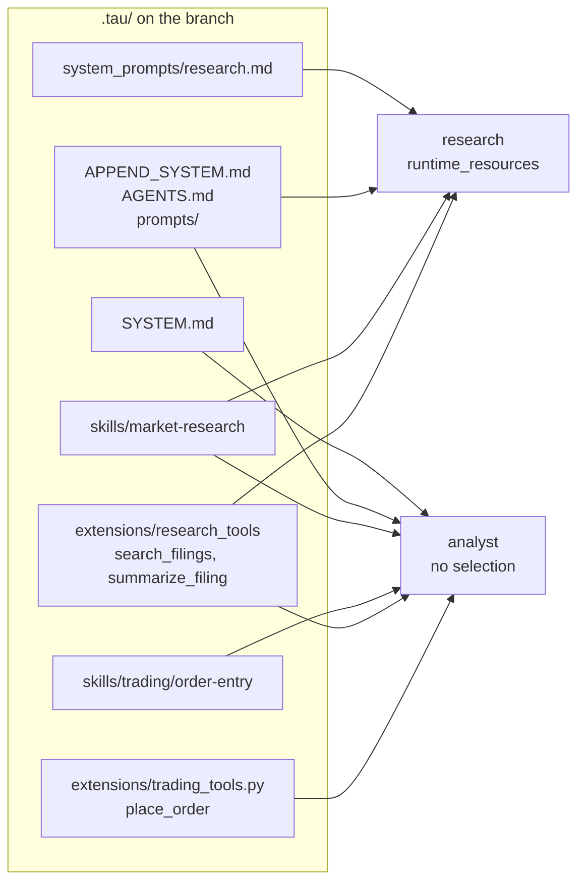
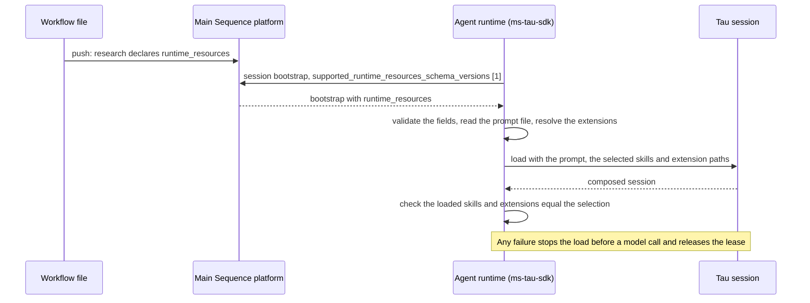

# Several Agents From One Repository

One repository branch can deploy several Agents. Each `harness_agent` resource in the workflow
file deploys its own Agent from the same code and image, with its own Agent Card, MCP applications,
policies and grants. With `runtime_resources`, each Agent also gets its own system prompt, skills
and project tools from the shared `.tau/` directory.

This guide implements [ADR 0026](../adrs/0026-per-agent-runtime-resources-from-the-workflow-declaration.md).
It needs the matching platform change; see [availability](#availability).

## The selection

An Agent's `harness_agent.spec.runtime_resources` has three optional fields:

| Field | Value | When omitted |
| --- | --- | --- |
| `system_prompt` | The workspace-relative path of a UTF-8 Markdown file under `.tau/`, outside `.tau/skills/`, `.tau/prompts/` and `.tau/extensions/`. | Tau's own choice: `.tau/SYSTEM.md`, else the SDK's packaged prompt. |
| `skills` | Skill names. A skill's name is its folder's name, wherever it sits under `.tau/skills/`. | Every project skill. |
| `extensions` | Entries directly under `.tau/extensions/`: an extension file such as `trading_tools.py`, or an extension folder such as `research_tools`. | Every project extension. |

Without `runtime_resources`, an Agent loads the whole `.tau/`, as before. An omitted field keeps
that behavior for its resource only. An empty list loads nothing: `skills: []` gives the Agent no
skills and `extensions: []` gives it no project tools. The selection applies to every session of
the Agent, on load and on reload. No setting, request, session or model response can change it.

These stay shared by every Agent of the repository:

- `.tau/APPEND_SYSTEM.md` and `.tau/AGENTS.md`, the branch-wide instructions;
- `.tau/prompts/`, the prompt templates;
- the prompt the SDK appends itself, such as the Main Sequence MCP resource prompt; and
- the process settings `TAU_EXCLUDE_BASE_TOOLS`, `TAU_EXCLUDE_MAINSEQUENCE_MCP` and
  `TAU_INCLUDE_DEVELOPMENT_RESOURCES`, which each Agent sets in its own `env_vars`.

## Example: a full assistant and a research Agent

A repository deploys an `analyst` that may research and place orders, and a `research` Agent that
only researches. The research Agent has its own prompt, one skill and one extension.

The repository's `.tau/` holds every resource once. Tools are grouped into extensions by the
Agents that use them:

```text
.tau/
├── SYSTEM.md                        the analyst's prompt
├── system_prompts/
│   └── research.md                  the research Agent's prompt
├── APPEND_SYSTEM.md                 shared by both Agents
├── AGENTS.md                        shared by both Agents
├── prompts/                         shared by both Agents
├── skills/
│   ├── market-research/SKILL.md
│   └── trading/
│       └── order-entry/SKILL.md
└── extensions/
    ├── research_tools/
    │   └── extension.py             search_filings, summarize_filing
    └── trading_tools.py             place_order
```

The workflow file declares both Agents. Only the research Agent selects its resources:

```yaml
api_version: "3.0.0"
name: agents
resources:
  - key: analyst
    kind: harness_agent
    spec:
      source_path: api/agent/main.py
      # The Agent's other settings. No runtime_resources: it loads the whole .tau/.
  - key: research
    kind: harness_agent
    spec:
      source_path: api/agent/main.py
      # The Agent's other settings.
      runtime_resources:
        system_prompt: .tau/system_prompts/research.md
        skills:
          - market-research
        extensions:
          - research_tools
```

Each Agent's sessions then load these resources:



| | analyst | research |
| --- | --- | --- |
| System prompt | `.tau/SYSTEM.md` | `.tau/system_prompts/research.md` |
| Shared instructions | `APPEND_SYSTEM.md`, `AGENTS.md` | `APPEND_SYSTEM.md`, `AGENTS.md` |
| Skills | `market-research`, `order-entry` | `market-research` |
| Project tools | `search_filings`, `summarize_filing`, `place_order` | `search_filings`, `summarize_filing` |

The research Agent's skill-scoped `read` and `/skill:<name>` work only on `market-research`.
Its model never sees `place_order`.

## How the selection reaches the session

The selection is part of the Agent's declaration, not of its environment. The platform returns it
with every session bootstrap, and the runtime checks it before and after Tau composes the session:



The runtime checks the selection on load, after every reload and before every turn:

- An unknown field, a value of the wrong type, a repeated name or a path outside its allowed place
  fails the load.
- The system prompt must exist, be a regular UTF-8 file, sit under `.tau/` and not be or pass
  through a symbolic link. The runtime reads it when the session loads; a reload keeps that
  content.
- Each selected skill must load. No other skill may load.
- Each selected extension must exist directly under `.tau/extensions/`, must not be a symbolic
  link and must be an extension Tau discovers there: a `.py` file, or a folder with
  `extension.py` or a `[tool.tau]` manifest. Every entry it holds must load without errors. No
  other project extension may load.

A selection never silently gives the model a different catalog. The error names what is wrong,
such as `Selected skills did not load: portfolio`.

## Selection is not authority

Every Agent of the repository runs the same code. A selection limits what the model is given,
not what is installed. The research Agent's image still contains `trading_tools.py`, and code in
a selected extension can import anything in the repository. With Tau's base tools, the model could
also read or run unselected code with `bash`.

What an Agent may do is decided by the platform, outside its container:

| | Controls | Enforced by |
| --- | --- | --- |
| `runtime_resources` | What the model is offered: prompt, skills and tools. | The Agent's runtime, when the session loads. |
| Grants and delegation | What each call may do, on the platform and in each application. | The platform and each application, on every call. |

When two Agents must differ in what they may touch, give each its own grants. For example, give
the research Agent read access only. Even if it ran the order code, the platform would refuse the
write. When an Agent acts for a person, each call is limited to that person's access as well. See
[what an Agent can reach on its own](../reference/security-model.md#what-an-agent-can-reach-on-its-own)
and [acting for the person](../reference/security-model.md#acting-for-the-person-acts_for_requester).

Use the selection to keep each Agent focused, and grants to keep it safe. To hide tools from the
model completely, also set `TAU_EXCLUDE_BASE_TOOLS` for that Agent, and remember that it does not
sandbox extensions either.

## Check what an Agent loaded

Each session load and reload logs `runtime.project_resources.load.completed`. With a selection, its
`runtime_resources` field holds the selected prompt path, skill names and extension entries, with
workspace-relative paths, and `system_prompt_files` starts with the selected prompt. The agent
inspection payload reports the same in `resources.selection`. Without a selection both are `null`.

## Local development

Local `ms-tau` has no platform bootstrap. It loads the whole `.tau/`, so a local session behaves
like an Agent without a selection. How to run one declared Agent locally is not decided yet.

## Availability

The SDK side ships in 2.0.30; see the [changelog](../../CHANGELOG.md). It also
needs the platform to accept `harness_agent.spec.runtime_resources` in the workflow file and return
it at session bootstrap. A runtime from an earlier release does not send
`supported_runtime_resources_schema_versions`, and the platform refuses to bootstrap an Agent that
declares a selection on it, rather than let it load the whole `.tau/`.
